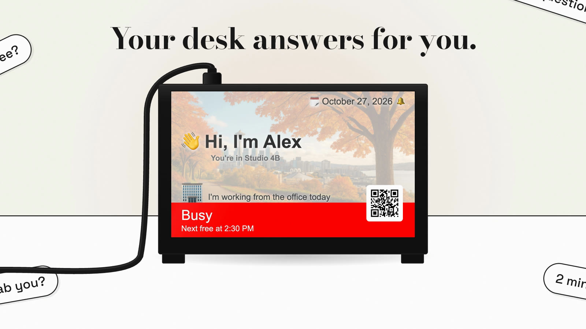
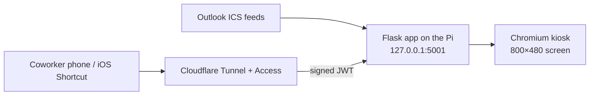

# Pronto

**A tiny Raspberry Pi screen that tells people walking by your desk whether you're free, without exposing your calendar.**

It reads your Outlook/Exchange calendar and shows 🟢 *Available*, 🔴 *Busy until 2:30*, 🟡 *Away* or 🟣 *Out of office*. Coworkers can scan a QR code and leave you a note that pops up on the screen.



## Features

- **Privacy first.** Busy shows "Next free at 2:30 PM", never meeting titles.
- **Real Outlook support.** Multiple ICS calendars, recurring events, exceptions, and OOO detection.
- **Where am I today?** Office/remote location from a schedule, with optional iOS Shortcut geofencing.
- **Leave a note.** Coworkers send short messages from their phone (`/msg`).
- **Looks good on a desk.** Seasonal backgrounds, sleeps outside business hours, built for an 800×480 kiosk.
- **Locked down by default.** Only localhost has access unless you add Cloudflare Access.

## How it works



## Quick start

```bash
git clone https://github.com/seriamo/pronto && cd pronto
python3 -m venv venv && source venv/bin/activate
pip install -r requirements.txt
cp .env.example .env        # set ICS_URL at minimum
python app.py               # → http://localhost:5001
```

Open **http://localhost:5001/admin** to preview every state (busy, free, OOO, away…) with mock data.
Set `FLASK_ENV=development` for the Flask debugger.

## Configuration

Everything lives in `.env`. See [`.env.example`](.env.example) for the full list.

| Variable | What it does |
|---|---|
| `ICS_URL` | **Required.** Your published calendar link. Treat it like a password. |
| `ICS_URLS_EXTRA` | Extra calendars, comma-separated |
| `TIMEZONE` | IANA timezone, e.g. `America/New_York` |
| `USER_NAME`, `ROOM_NUMBER` | Greeting and location shown on screen |
| `OOO_KEYWORD` | Event-title prefix that counts as out-of-office (e.g. `jdoe ooo`) |
| `OFFICE_DAYS`, `OFFICE_HOURS` | Default "in office" schedule |
| `LOGO_FILE`, `QR_FILE` | Optional corner logo and QR image, placed in `static/custom/` (gitignored). No logo? The QR code takes the corner. |
| `PUBLIC_URL` | Your tunnel URL; used to generate the "leave a note" QR code |

Drop photos into `static/easter-eggs/` (gitignored) and they'll show behind messages.

## Run it on a Raspberry Pi

```bash
./deploy_to_pi.sh pi@raspberrypi.local                         # copy files, install deps, restart
ssh pi@raspberrypi.local 'cd ~/desk_display && ./kiosk_setup.sh' # first time only: service + kiosk
```

See [docs/deployment.md](docs/deployment.md) for Cloudflare Tunnel/Access setup and troubleshooting. See [docs/ios-shortcuts.md](docs/ios-shortcuts.md) for location and OOO automations.

## Security

The app binds to `127.0.0.1`, so out of the box only the Pi itself can reach it. For remote access, put it behind a [Cloudflare Tunnel](https://developers.cloudflare.com/cloudflare-one/connections/connect-networks/) and [Access](https://developers.cloudflare.com/cloudflare-one/applications/). The app verifies every Access JWT itself: signature, audience, issuer and expiry. It does not trust forwarded headers.

| Role | Who | Can use |
|---|---|---|
| **Owner** | localhost, `TRUSTED_NETWORKS`, `OWNER_EMAILS`, `OWNER_SERVICE_TOKENS` | Everything, including `/admin` and the location/OOO APIs |
| **Coworker** | Any email signed in through Access | `/msg` |
| **Viewer** | Any Access identity, or anyone if `PUBLIC_DISPLAY=true` | The display and `/api/status` (times only, no titles) |

The app also:
- blocks cross-site POSTs
- sends a strict CSP and security headers
- rejects non-local `Host` headers on loopback, which prevents DNS rebinding
- never logs or returns your calendar URL

Found a vulnerability? See [SECURITY.md](SECURITY.md).

## Project layout

```
app.py              Flask app: calendar parsing, status logic, auth, API
templates/          display (kiosk), message (/msg), admin/debug pages
static/             seasonal backgrounds, logo; custom/ + easter-eggs/ are yours
deploy_to_pi.sh     rsync deploy · kiosk_setup.sh first-time Pi setup · auto_update.sh weekly OS updates
docs/               deployment and iOS Shortcut guides
```

## License

[MIT](LICENSE)
